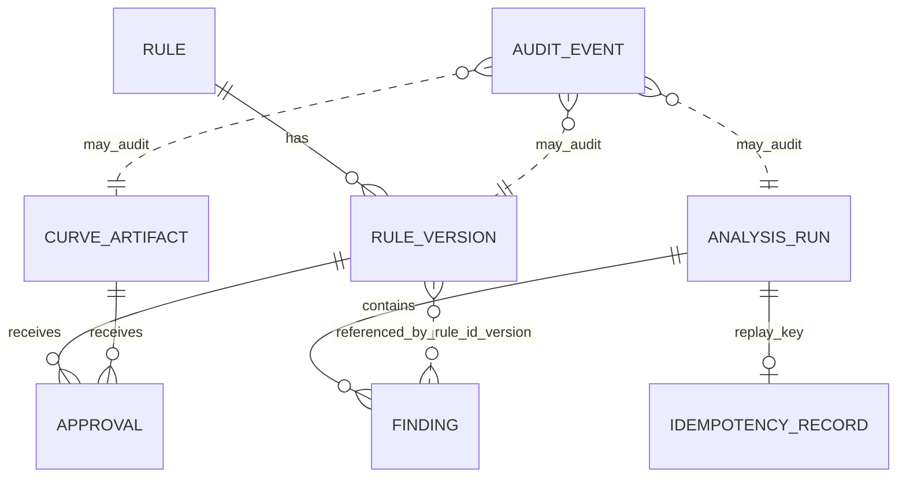

# G2 API 与数据契约设计说明

- 版本：G2 MVP 0.2.0
- API：REST / JSON，OpenAPI 3.1
- ORM：SQLAlchemy 2.x
- 数据库：SQLite（开发/单机验证）；生产推荐 PostgreSQL
- Migration：Alembic

## 1. 分层边界

- API 层：请求校验、认证门禁、分页、错误映射、幂等、审计。
- Domain/service 层：规则 Schema 校验、内容哈希、规则生命周期、分析编排。
- G1 engine：只负责确定性表达式/曲线/插件执行，不负责 HTTP、数据库或用户身份。
- Persistence：规则主记录、不可变规则版本、曲线工件、分析运行、Finding、Approval、AuditEvent、IdempotencyRecord。

LLM 不参与规则计算；API 当前不调用 LLM。

## 2. 资源与状态

### Rule / RuleVersion

`rules` 保存稳定规则身份；`rule_versions` 保存不可变定义快照。唯一约束 `(rule_pk, version)`。新规则和新版本必须以 `draft` 创建；发布通过 Approval 记录完成。内容以规范 JSON SHA-256 保存 `content_hash`。不提供覆盖更新接口，修订必须新增版本。

RuleVersion 状态：`draft -> published`；拒绝发布回到 `draft`。更完整的 `in_review/tested/shadow/deprecated` 状态流将在后续版本补齐。

### AnalysisRun / Finding

一次分析保存输入快照、请求人、状态、汇总计数；每条规则执行结果写为独立 Finding，保留规则版本、严重度、状态、结果与错误码。G2 当前采用同步执行，HTTP 200 返回，状态在一次请求内 `running -> completed`；G8 再引入持久化队列和 worker。

### CurveArtifact

曲线保存 X/Y 单位、网格、插值方法、来源引用、SHA-256。新增曲线默认未批准；分析只加载 `approved=true` 的曲线。checksum 计算口径：对 `id/x_unit/y_unit/z_unit/x_values/y_values/z_values/interpolation` 按 key 排序、紧凑 JSON 编码后做 SHA-256；`source_ref` 不参与数值内容校验，但必须保存为追溯信息。

### Approval / AuditEvent

审批对象支持 `rule_version` 和 `curve`。创建者不能审批自己的工件（creator != approver）。每次创建、测试、发布、曲线导入、曲线审批和分析都会产生审计事件。

### IdempotencyRecord

分析请求可传 `Idempotency-Key`（8–128 位安全 ASCII）。相同 key + 相同规范请求哈希返回原结果；相同 key + 不同请求返回 409 `IDEMPOTENCY_CONFLICT`。当前无自动 TTL 清理，生产需配置保留策略。

## 3. API 清单

| Method | Path | Purpose |
|---|---|---|
| GET | `/health` | 健康检查（不要求 API key） |
| GET | `/openapi.json` | OpenAPI 3.1 |
| POST | `/v1/rules` | 创建 draft 规则 |
| GET | `/v1/rules` | 分页查询规则版本 |
| GET | `/v1/rules/{rule_id}` | 读取最新/指定版本 |
| POST | `/v1/rules/{rule_id}/versions` | 创建不可变新版本 |
| POST | `/v1/rules/{rule_id}:test` | 使用 G1 执行单条规则 |
| POST | `/v1/curves` | 导入待审批曲线工件 |
| GET | `/v1/curves/{curve_id}` | 查询曲线工件及审批状态 |
| POST | `/v1/approvals` | 审批发布规则或批准曲线 |
| POST | `/v1/analyses/derating` | 同步执行已发布降额/电源/热规则 |
| GET | `/v1/analyses/{run_id}` | 查询分析运行 |
| GET | `/v1/analyses/{run_id}/findings` | 分页查询 Finding |
| GET | `/v1/audit-events` | 查询审计事件 |

请求/响应字段和错误模型以 `openapi/openapi.json` 为机器契约；服务运行时 `/openapi.json` 是权威生成文档。

## 4. 认证与部署边界

设置 `RELIABILITY_API_KEY` 后，除 `/health` 与 `/openapi.json` 外，API 要求 `Authorization: Bearer <key>`。未设置时为本地开发模式，不应暴露到公网。当前为单一共享 API Key；`X-Actor-ID` 仅用于审计主体标识，可被调用方自行填写，不是身份认证凭证。因此“创建者不得自批”目前仅是基于声明身份的流程检查，不构成真实身份隔离。G2 尚未实现多用户 RBAC、OIDC、租户隔离或细粒度权限；生产上线前必须补齐。

## 5. 数据库与事务

所有写操作在同一数据库事务中提交；唯一键和外键由数据库强制。生产使用 PostgreSQL，并启用备份、恢复演练和 TLS。SQLite 仅用于开发和小规模单机 PoC。使用 Alembic 执行版本迁移，禁止生产环境直接 `metadata.create_all()`。

## 6. G2 明确未覆盖

- 异步队列、任务取消、重试、分布式锁。
- RBAC / SSO / OAuth2 / 多租户数据隔离。
- 规则编辑 UI、完整状态机和双人审批工作流（当前实现创建者不得自批）。
- 曲线文件上传解析、数据数字化工具、曲线来源真实性审核。
- 大规模分页游标、速率限制、API 版本兼容策略。
- 生产 PostgreSQL HA、备份恢复和运维监控（G8）。

## 7. 逻辑数据关系（简化）

说明：Finding 通过 `rule_id + rule_version` 保存规则版本引用信息，当前不建立跨表外键，以保留规则归档/迁移的松耦合。AuditEvent 使用通用 `resource_type + resource_id` 关联目标，不使用多态外键。
